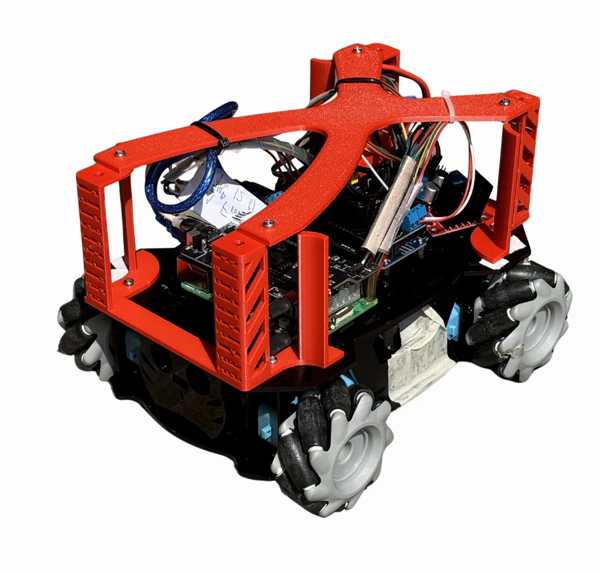
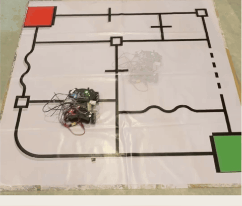
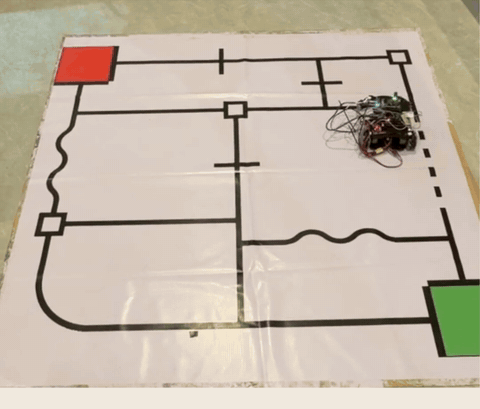
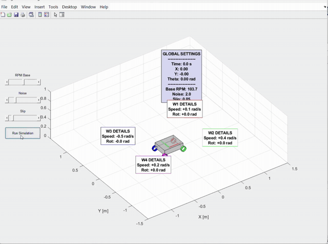
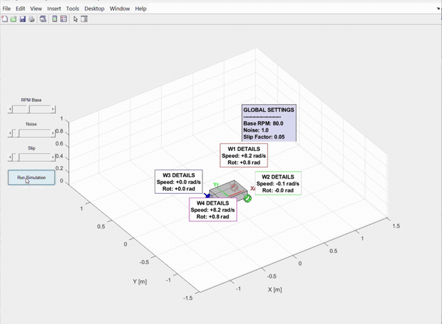
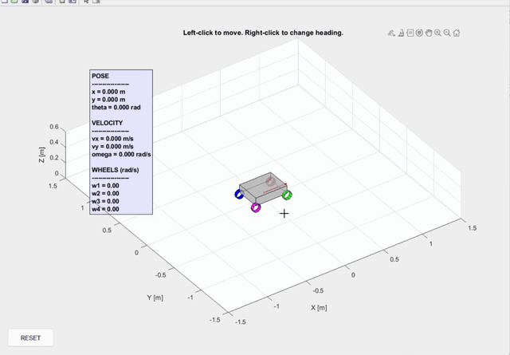
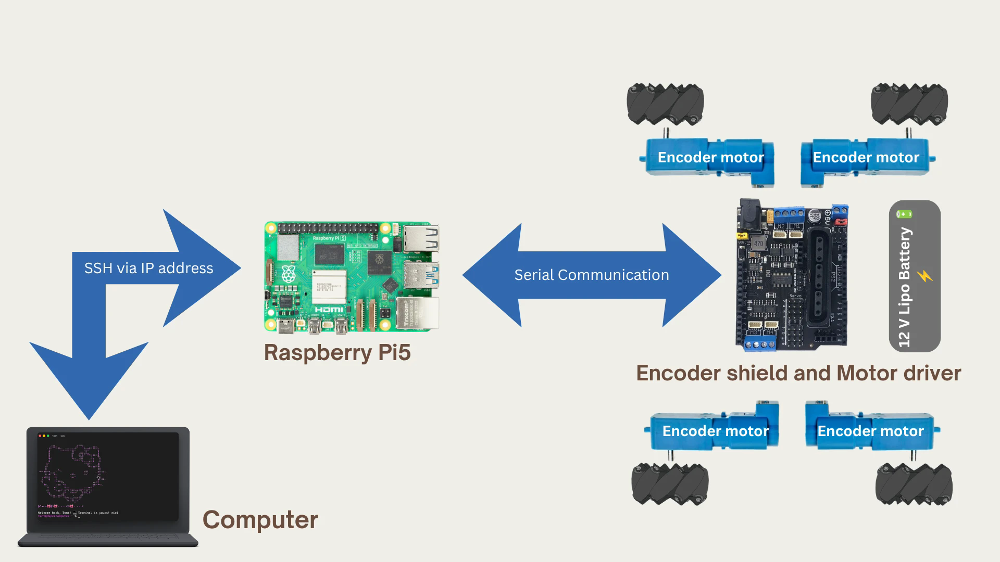

# KD_2026 — Mecanum Wheel Robot (Kinematics & Control)

A 4-wheel **mecanum-drive robot** controlled by a **Raspberry Pi 5**. The Pi turns a desired body motion (or a target position) into individual wheel RPMs using mecanum kinematics, and sends them over serial to a motor driver / encoder board that drives four encoder motors.

<p align="center">
  
</p>

---

## Demo

### Real robot

<p align="center">
  
  &nbsp;
  
</p>

### MATLAB simulation

| Forward kinematics: set base RPM, noise and slip, then run | Forward kinematics (second run) |
|---|---|
|  |  |

**Inverse kinematics (live):** left-click to set a target position, right-click to change the heading. The panel shows pose, body velocity and the wheel speeds needed to get there.

<p align="center">
  
</p>

---

## System overview

<p align="center">
  
</p>

| Part | Role |
|---|---|
| **Computer** | Connects to the Pi over **SSH** (via its IP address) to run scripts |
| **Raspberry Pi 5** (`master_pi_5/`) | The "master": computes kinematics, sends RPM commands, reads encoder ticks |
| **Encoder shield + motor driver** | The "slave": receives RPM packets over **serial**, drives the motors, reports encoder counts |
| **4 × encoder motors + mecanum wheels** | Drive the robot in any direction |
| **12 V LiPo battery** | Powers the motors |

### Serial protocol

Both directions use a simple bracketed, comma-separated packet at **115200 baud**:

| Direction | Packet | Example |
|---|---|---|
| Pi → motor driver | `<m1,m2,m3,m4>` target RPMs | `<50,50,-50,-50>` |
| Encoder board → Pi | `<m1,m2,m3,m4>` encoder ticks | `<1203,1198,1210,1201>` |

### Wheel layout

From [`master_pi_5/Robot_direction.md`](master_pi_5/Robot_direction.md):

```
 m4    Front    m1
 m3            m2
```

---

## Kinematics

Robot parameters (in metres):

| Symbol | Value | Meaning |
|---|---|---|
| `r` | 0.0315 | Wheel radius (63 mm wheel) |
| `L` | 0.1001 | Half wheelbase |
| `W` | 0.0940 | Half track width |
| `MAX_RPM` | 255 | Motor speed limit |

### Body velocity → wheel speed (`maccanum_matrix.py`)

Given forward speed `vx`, sideways speed `vy` and rotation `ωz`:

```
ω1 = (1/r) · (vx − vy − (L+W)·ωz)
ω2 = (1/r) · (vx + vy + (L+W)·ωz)
ω3 = (1/r) · (vx + vy − (L+W)·ωz)
ω4 = (1/r) · (vx − vy + (L+W)·ωz)

RPM = ω · 60 / 2π
```

If any wheel goes over `MAX_RPM`, all four are meant to be scaled down by the same ratio so the direction of motion stays the same.

### Target position → body velocity (`position_to_velocity_matrix.py`)

To reach a target `(x, y, θ)` in time `dt`, the position change is rotated into the robot frame and divided by `dt`:

```
dx_local =  dx·cos θ + dy·sin θ
dy_local = −dx·sin θ + dy·cos θ

vx = dx_local / dt,   vy = dy_local / dt,   ωz = dθ / dt
```

Those velocities then go through the same wheel-speed equations.

### Encoder odometry

Distance per encoder tick = `π · wheel_diameter / ticks_per_rev`. The tick count per revolution is measured with `tickperrev.py`.

---

## Repository structure

```
KD_2026/
├── master_pi_5/                       # Runs on the Raspberry Pi 5
│   ├── Forward_kine.py                # Enter vx, vy, ωz, time → drive the robot
│   ├── Inverse_kine.py                # Enter target x, y, heading, time → drive there
│   ├── maccanum_matrix.py             # Body velocity → wheel RPM
│   ├── position_to_velocity_matrix.py # Target position → body velocity → RPM
│   ├── control_motor.py               # Serial connection + send <m1,m2,m3,m4> RPM packet
│   ├── read_encoder.py                # Serial connection + read encoder tick packets
│   ├── tickperrev.py                  # Calibrate ticks per wheel revolution by hand
│   ├── count_cm.py                    # Drive a set distance using encoder feedback
│   ├── rpm_controller.py              # Debug tool: print incoming RPM data
│   ├── raw_motor_control.py           # Drive all motors at a fixed PWM
│   ├── checkup.py                     # Check both serial connections
│   ├── master.py                      # Serial test with the RP2350 board (buzzer / LED)
│   ├── Robot_direction.md             # Wheel numbering
│   └── mai_chai_laew/                 # Old / unused scripts
├── slaves_2350_pro/firmware_2350/     # RP2350 firmware (buzzer, RGB LEDs, servos)
├── Serial_test/                       # Arduino serial test sketch
├── simulation/test.m                  # MATLAB frame-transformation test
├── media/                             # Images and GIFs used in this README
└── environment.yaml                   # Conda environment
```

---

## Getting started

### 1. Set up Python

```bash
conda env create -f environment.yaml
conda activate KD_2026
```

On the Pi, only `pyserial` is required:

```bash
pip install pyserial
```

### 2. Connect to the Pi

```bash
ssh <user>@<pi-ip-address>
```

### 3. Run

The scripts expect the motor/encoder board on `/dev/ttyUSB0` at 115200 baud. Change this at the top of each script if your port is different.

```bash
cd master_pi_5

# Calibrate encoder ticks per revolution (turn a wheel exactly once by hand)
python tickperrev.py

# Forward kinematics: give velocities, the robot drives
python Forward_kine.py

# Inverse kinematics: give a target position, the robot drives there
python Inverse_kine.py
```

Both kinematics scripts drive the motors for the given time, stop them, and print the expected final position.
